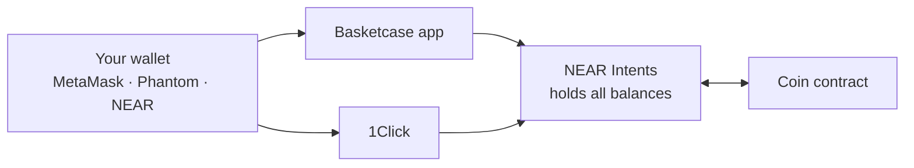
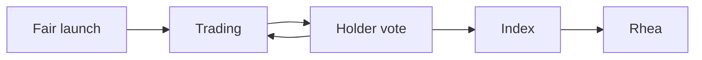
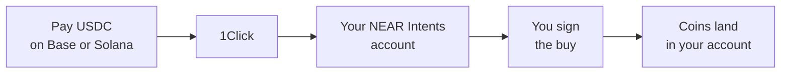
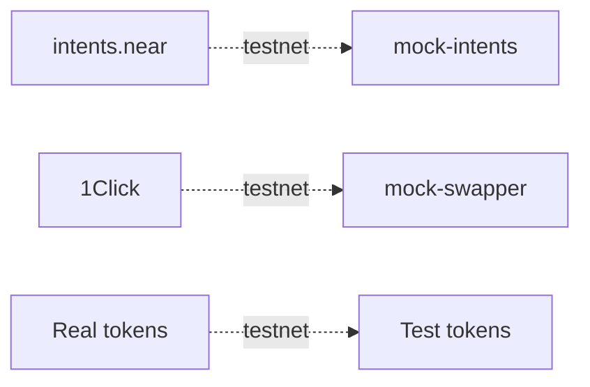

# Architecture

How Basketcase works on **NEAR mainnet**, and what is swapped for a stand-in on **testnet**. Exact contract methods are in [docs/interface.md](docs/interface.md); every claim with its evidence is in [docs/technical.md](docs/technical.md). What has run with real money on mainnet (one MetaMask round trip from Base) and what hasn't is listed in the [README](README.md#live-on-near-mainnet).

## The pieces



- **Coin contract** (`contracts/coin`, math in `crates/curve-math`). One contract per coin. It holds its basket inside NEAR Intents, prices the coin on a bonding curve, computes the floor, runs the holder vote and the swap auction, and graduates into an index. It never reads a price for buys, sells or the floor.
- **NEAR Intents** (`intents.near`). Holds every balance: the coin's vault, and each buyer's coins and assets under the buyer's own address (the lowercase EVM address for MetaMask, the hex public key for Phantom). Nothing leaves an account there without that account's signature.
- **1Click.** Brings USDC from Base or Solana into NEAR Intents, swaps it into the basket assets, and sends USDC home on cash-out.
- **Relayer** (`router.basketcase.near`). Submits the buyer's already-signed messages and pays the NEAR gas (about 0.002 NEAR a trade). It cannot change, redirect or spend them.
- **Web app** (`web/`). The pages, the X player card (`/x/<coin>`), and `/api/xbuy`, which builds the messages to sign and follows each order. Orders are kept in MongoDB so any server instance can pick them up.

## A coin's life



- **Basket.** 1–9 assets, any token NEAR Intents holds. A buy sends the whole basket into the coin's vault.
- **Floor**, in basket units per token: `x0/y0 + surplus/sold` before graduation, `reserve/supply` after. 30% of each 1% fee and every burned token stay in the vault, so fees push the floor up. It moves with the assets' prices and is not a guarantee.
- **Vote.** Holders burn tokens to challenge a non-anchored asset or defend it; the bigger side wins if it burned at least 3% of that asset's share. A Dutch auction from 20% above the fair rate swaps the asset.
- **Graduation.** Minting stops, 20% of the backing seeds a built-in pool, and the keeper (`scripts/src/keeper.ts`) lists the coin on Rhea. That listing runs on testnet today; on mainnet it is switched off (`RHEA_AUTO=1`) until we fund it.

## Buying from Base or Solana



**Sell and cash out** run the same way in reverse: the buyer signs a withdrawal of their coins to the coin with a sell message (the coin pays the basket back into their account; a sell that can't fill returns the coins), then signs 1Click swaps that send USDC to their wallet on Base or Solana.

What protects the buyer (code: `packages/client/src/intents.ts`, `web/src/components/coin/xchain-buy.tsx`):

- The wallet signs every move; the relayer only pays gas.
- The browser fills in the signer, the NEAR Intents contract and the coin itself, caps spending across all of an order's messages, and asks 1Click directly that every deposit address is a real quote paying and refunding only the buyer.
- If a step fails, the funds stay in the buyer's own NEAR Intents account, and Cash out sends them home.

## Code map

- `crates/curve-math`: curve, fee, pool, redeem and floor math (pure Rust, property-tested).
- `contracts/coin`: one coin. `contracts/factory`: launches keyless coins (testnet).
- `packages/client`: typed reader, transaction and intent builders, signing checks.
- `web/`: Next.js app. `src/lib/server/xbuy.ts` is the cross-chain order flow; `src/lib/network.ts` picks the network.
- `scripts/`: deploy, `mainnet-coin`, `mainnet-wallet`, `keeper`, `demo`, and the checks below.
- `sim/`: a 60-day simulation of the curve and floor ([docs/simulation.md](docs/simulation.md)).

## Testnet: what is mocked

The full product runs on NEAR testnet with the same coin contract and web app. NEAR Intents and 1Click don't exist on testnet, so stand-ins with the same call shapes take their place:



Also on testnet only: short timings (2-minute fair launch, 10-minute voting rounds and 2-minute auctions instead of 10 minutes, 7 days and 1 hour), the keeper service closing rounds and listing on Rhea's testnet deployment, and trades from our own test accounts, labelled as test traders.

## Run and check

```bash
pnpm install
pnpm verify                                   # Rust, simulator, unit tests, typecheck, browser smoke tests
pnpm --filter scripts intents:check           # mainnet NEAR Intents accepts our signatures (read-only)
SITE=https://basketcase-near.vercel.app pnpm --filter scripts mainnet:dryrun degen.basketcase.near   # no money moves
PRESET=memes pnpm --filter scripts demo <you.testnet>   # a full coin life on testnet, ~15 min
```
