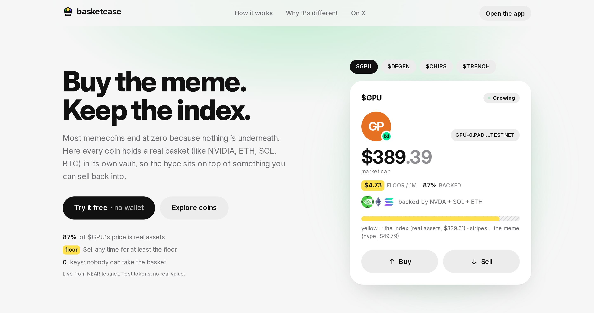
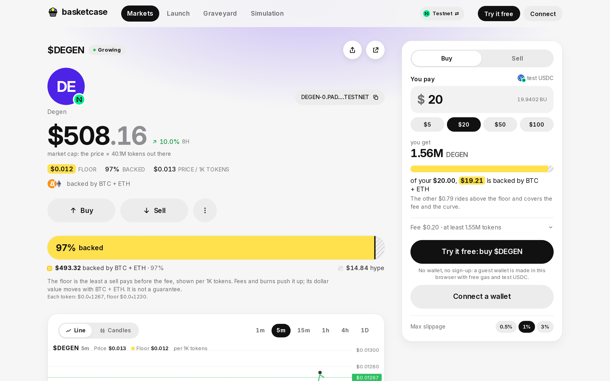
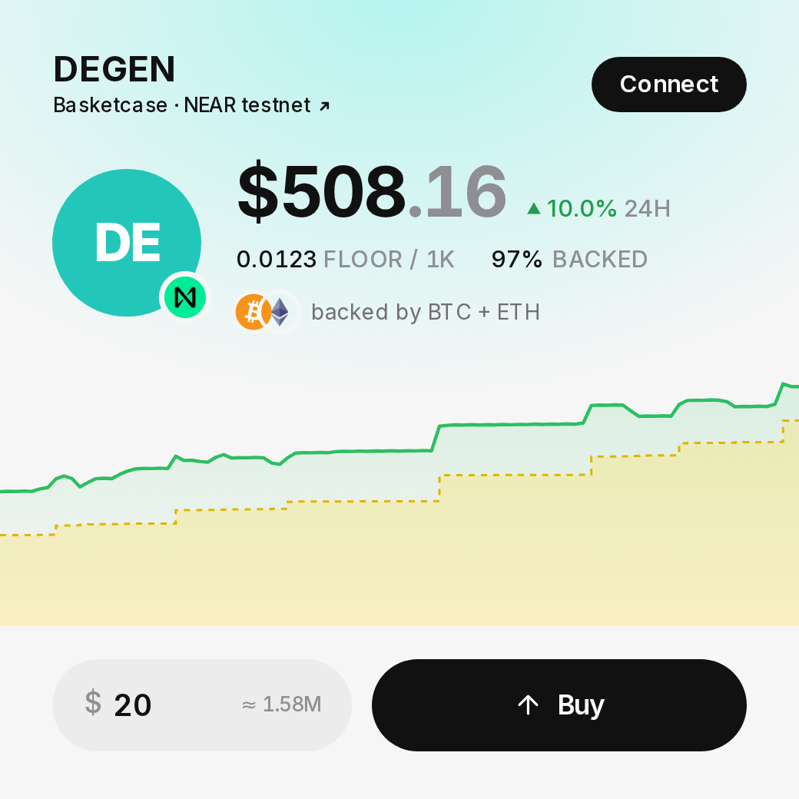

<p align="center">
  
</p>

<p align="center">
  <b>Memecoins with a basket of real assets underneath.</b><br>
  Built on <b>NEAR Intents</b> for NEAR HACKATHON 2026 · live on <b>NEAR mainnet</b> and testnet
</p>

<p align="center">
  <a href="docs/media/basketcase-product.mp4"></a>
  <br><sub>▶ Click to watch the product demo (72 s, narrated) (<code>docs/media/basketcase-product.mp4</code>)</sub>
</p>

---

## The problem

| | What goes wrong today |
|---|---|
| 🪦 **Nothing underneath** | A memecoin is pure attention. When the hype ends it goes to zero, or it gets rugged, because no asset backs it. |
| 🌉 **Liquidity split across chains** | The coin you want is on another chain: bridge, new wallet, new seed phrase, buy gas first. Most people give up. |
| 📱 **Found on X, traded elsewhere** | People discover coins in their X feed, then have to leave it, open an app and connect a wallet to buy. |

## How Basketcase solves it

- **Every coin holds a basket.** The creator picks 1–9 real assets from any chain NEAR Intents holds (BTC, ETH, SOL, NVIDIA via Ondo, NEAR memes like BLACKDRAGON…). Buying a coin buys the basket, and it sits in the coin's own vault.
- **A floor the contract computes.** A line like "every token is backed by $1.30" (the illustrative figure in our images) is arithmetic on the coin's own state, never a price feed. 30% of every fee goes to the vault, so fees push the floor up. (The floor is the least a sell pays, before the fee; not a guarantee.)
- **Holders run the basket.** Each round, holders burn tokens to vote an asset out; a Dutch auction swaps in the replacement.
- **Memecoin today, index tomorrow.** At 20,000 basket units the coin graduates into an index fund and is listed on Rhea (NEAR's DEX) automatically.
- **Buy from any chain.** Pay with USDC on Base (MetaMask) or Solana (Phantom): one transfer, then you sign messages. No bridge, no new wallet, no NEAR gas, and the coins land under your own wallet's address.
- **Buy inside your X feed.** A coin's link unfurls into a live card in the post: buy in one tap, sell in one more.

## Tokenomics

<p align="center"></p>

<details>
<summary><b>Tokenomics in numbers</b> (every value, with where it comes from)</summary>

| Parameter | Value | Source |
|---|---|---|
| Basket | 1–9 assets, any token NEAR Intents holds; weights set at launch | `constants.json` `launch.basket_assets` |
| Basket unit (BU) | one fixed amount of each asset; worth $1 at launch | `launch.bu_usd_default` |
| Fair launch | 10 min (testnet demo: 2 min); queued buys all mint at one average price; cap 18,000 BU, minimum 1 BU | `launch.fair_launch_window_s`, `queue_cap_bu`, `min_queue_bu` |
| Bonding curve | constant product on virtual reserves of 5,000 BU and 1,073,000,000 tokens (the Pump.fun shape) | `curve.virtual_bu`, `curve.virtual_tokens` |
| Trading fee | 1% by default; a creator can set 0.25–1% | `fees.trade_fee_bps` |
| Fee split | 50% creator, 30% vault (raises the floor), 20% protocol | `fees.split_bps` |
| Floor before graduation | `x0/y0 + surplus/sold` in BU per token: the curve's lowest price plus the vault surplus per sold token | `crates/curve-math`, `get_state` |
| Floor after graduation | `reserve/supply` | `crates/curve-math`, `get_state` |
| Voting round | 7 days (testnet demo: 10 min) | `epochs.len_s` |
| Challenge rule | burn tokens to challenge or defend an asset; the biggest challenge wins if it beats the defense and burned at least 3% of the asset's share of the vault; at most 32 open per round; burns are never refunded | `challenge.min_burn_bps_of_slot`, `max_open_per_epoch` |
| Swap auction | Dutch auction from 20% above the fair rate down to it (never below), over 1 hour (demo: 2 min); partial fills allowed | `auction.start_premium_bps`, `auction.len_s` |
| Graduation | at 20,000 BU in the curve: minting stops, 20% of the backing seeds a built-in pool, and the keeper lists the coin on Rhea | `curve.graduation_reserve_bu`, `graduation.pool_share_bps`, `scripts/src/keeper.ts` |
| After graduation | a sell pays the better of the pool price or redeeming a share of the vault; 0.5% of a redeem stays in the vault | `fees.redeem_fee_bps` |
| Prices | only set an auction's starting rate; buy, sell, redeem and the floor never read a price | `AGENTS.md` invariants |

The floor is the least a sell pays before the fee. Its dollar value moves with the basket's assets, and it is not a guarantee.
</details>

## NEAR memes, meme.cooking and Rhea (run on testnet)

A coin made of NEAR's own memes, run through its whole life: launch, fair launch, trading, a holder vote that swaps an asset, graduation into an index, and the automatic Rhea listing. **We ran this on NEAR testnet because we don't have funds on mainnet for it at this moment**; it uses the same contracts and the same keeper as mainnet, with test tokens standing in for JAMBO, BLACKDRAGON, SHITZU and PEPE.

**$COOK951** ([`cook951-0.pad.backedlab.testnet`](https://testnet.nearblocks.io/address/cook951-0.pad.backedlab.testnet)) started with **JAMBO** (a meme.cooking token, anchored), **BLACKDRAGON** and **SHITZU**. Holders voted SHITZU out for **PEPE**, and the coin graduated and was listed on Rhea as **[pool #2982](https://testnet.rhea.finance/pool/2982)** with no one touching it.

| Step | What happened | Transaction |
|---|---|---|
| Launch | Basket: JAMBO (meme.cooking) 34%, BLACKDRAGON 33%, SHITZU 33% | [SUrLbEPp…](https://testnet.nearblocks.io/txns/SUrLbEPpRfhNdSUj9yspzZBrtD7uGZyGRXnav6F3BJS) |
| Fair launch | Two buyers' deposits settle at one average price (1 : 3 tokens, like their deposits) | [5jjUWSgn…](https://testnet.nearblocks.io/txns/5jjUWSgnyNXhRXF8Zwda8wsJCsHeoQw8nPANbgjS2noK) |
| Trade | A buy and a sell on the curve | [P5ySw6LB…](https://testnet.nearblocks.io/txns/P5ySw6LBcMDDByMvkXRVEUKwJtQFS8uURGfpBDyQam3), [HS919pnA…](https://testnet.nearblocks.io/txns/HS919pnADrJvLf4mEbSFjHhQZcLo6KoDy4eLmdiAf7xy) |
| Vote | A holder burns 77.5 BU to vote SHITZU out for PEPE; another burns 7.6 BU to defend it | [CUThHwNy…](https://testnet.nearblocks.io/txns/CUThHwNyW4d9T7ik1TYpUjQiJAxwzUvJdBNhGJS17JsB), [GHXAzqLS…](https://testnet.nearblocks.io/txns/GHXAzqLSrEHgSrUwJEErcm65Mi8E9Pwn1rWbLcwiEKxY) |
| Round closes | The keeper closes the round; the challenge wins and a swap auction opens | [3ghfviqv…](https://testnet.nearblocks.io/txns/3ghfviqvyS1KG76LzZAGcfzEjMZFNfDKBqy5n4YA9XE5) |
| Swap | The auction fills: PEPE in, SHITZU out to the graveyard | [46REtEPk…](https://testnet.nearblocks.io/txns/46REtEPkRpMPfhs9d1rGtWHymx9wbTQMFZbgCJh8n3Kw) |
| Graduation | The curve reaches 20,000 BU: minting stops, the built-in pool opens, the coin becomes an index | [DtXZx5tf…](https://testnet.nearblocks.io/txns/DtXZx5tfKLuHrdCykRLn6VmE8g3TGvpqwoLGXCUWxCwp) |
| Rhea listing (automatic) | The keeper registers the tokens, creates the pool and adds liquidity | [ABLHinA5…](https://testnet.nearblocks.io/txns/ABLHinA576F1Xy7zqqWB29PPEYyAEG3t2VLMbxpDt5YR), [84VjR5kV…](https://testnet.nearblocks.io/txns/84VjR5kVmc5JsoZvTnB4GHSpMjYRbmjR8XLXw71ZH3u8), [DuEHssCm…](https://testnet.nearblocks.io/txns/DuEHssCm7iqREyHPwhgYdJUMFESpzKgrXcGtgbVb51Xn) |

Two earlier testnet coins graduated and were listed the same way: $AI ([pool #2977](https://testnet.rhea.finance/pool/2977)) and $DEMO1283 ([pool #2975](https://testnet.rhea.finance/pool/2975)). The Markets page also lists meme.cooking's graduated memes live from its public API, and a coin's basket can start from any of them. Rerun the whole story yourself: `PRESET=memes pnpm --filter scripts demo <your-account.testnet>`.

## Why it's different

| | Typical memecoin launchpad | **Basketcase** |
|---|---|---|
| What backs a coin | Nothing | A basket of real assets in the coin's vault |
| The floor | None | Computed by the contract; fees and burns only raise it |
| Who controls the backing | A team wallet | Nobody: coin accounts have no keys (testnet); holders vote on assets |
| Assets from other chains | Bridge them yourself | BTC, ETH, SOL, NVDA, NEAR memes in one basket via NEAR Intents |
| Paying from another chain | Bridge + new wallet + gas | One USDC transfer from MetaMask or Phantom |
| Where you trade | Leave X for an app | Inside the X post |
| End state | Dies or lives on a DEX | Graduates into an index, listed on Rhea automatically |
| Launch fairness | Snipers and bots win | Fair-launch window: everyone gets the same average price |

## See it

| Landing | Coin page |
|---|---|
|  |  |
| **Markets** | **The X card, inside a post** |
|  |  |

**Try it** (no wallet needed on testnet: a guest wallet with test tokens is made for you):
- Testnet app: https://fortune-literacy-counter-exceed.trycloudflare.com
- Mainnet app: https://basketcase-near.vercel.app

## Live on NEAR mainnet

$DEGEN (50% BTC, 50% USDC) is deployed at [`degen.basketcase.near`](https://nearblocks.io/address/degen.basketcase.near).

| Step | Transaction |
|---|---|
| Master account `basketcase.near` registered | [GFUK9C6z…](https://nearblocks.io/txns/GFUK9C6zUKa2RTx27yuamJa1Gv4oPJvFHFDitm7r42kj) |
| Coin account `degen.basketcase.near` created | [ZjHSwTBL…](https://nearblocks.io/txns/ZjHSwTBL3QgaMrdZSwE7NVqiA1scTZm8mxnMFJ4jJgk) |
| Coin contract deployed and initialised (`new`) | [GXP7y1NP…](https://nearblocks.io/txns/GXP7y1NPvSz7caavk7mwCq9FeNoA2J2xT3ENLPug5DBE) |
| NEAR Intents registered on the coin (`storage_deposit`) | [2GRnJQf7…](https://nearblocks.io/txns/2GRnJQf7oGdSwDKo6x1ZU9scssqBC3BEYcdMYXpochgM) |
| Gas relayer `router.basketcase.near` created | [2T82V7a3…](https://nearblocks.io/txns/2T82V7a3nbr6M8zBXpHPkzbZjppzSyrBfGAYfhMN6cb2) |

### First real round trip: Base → $DEGEN → Base

A MetaMask wallet paid **$0.50 USDC on Base**, bought $DEGEN, sold it, and cashed out **$0.485 USDC back on Base** (1.5¢ in fees: 1% to buy, 1% to sell, and swap spreads). Every step was signed by that wallet; our relayer only paid NEAR gas.

| Step | What happened | Transaction |
|---|---|---|
| 1. Pay | 0.50 USDC sent from MetaMask on Base to a 1Click deposit address | [Base 0x35e06256…](https://basescan.org/tx/0x35e06256083275aab864aa30bb6ad6aabd5c8045a9dcedfc57d9db67a149bff2) |
| 2. Arrive | 0.4999 USDC credited in NEAR Intents to the wallet's own account (`0x16db…d8a5`) | [Fahqjwxx…](https://nearblocks.io/txns/FahqjwxxRywSRYHsGt7ZAHLe9A6YtKDNxKh3V9599xjJ) |
| 3. Swap | The wallet's signed 1Click swap: 0.2408 USDC → 368 sats of BTC | [4UnCMPhS…](https://nearblocks.io/txns/4UnCMPhSVa5Nu4X4PYLeSdkVQyf6SYGkkZuTvdU24UAX) |
| 4. Buy | The wallet's signed buy, relayed: the basket goes into the coin's vault and **102,064 $DEGEN** mint into the wallet's NEAR Intents account | [Hd6s4wEF…](https://nearblocks.io/txns/Hd6s4wEFpYdcyb1xTu2p3iycr1HB3t1N1mxcNRXsxhCb) |
| 5. Sell | The wallet's signed sell, relayed: the coin burns the tokens and pays the basket back | [2Pv3XVJn…](https://nearblocks.io/txns/2Pv3XVJnGx6NhMAj1xBjShwsB4VeeF8akTa8xQzu87p9) |
| 6. Cash out USDC | 0.2550 USDC → 0.2526 USDC on Base | [Base 0x250a7700…](https://basescan.org/tx/0x250a770040122fc35683fb10fbe61f947d739143a32f618816041c67ed8b8ded) |
| 7. Cash out BTC | 361 sats → 0.2328 USDC on Base | [Base 0x82c61cb0…](https://basescan.org/tx/0x82c61cb00f28d7e8c7140ef6f8b9ed9054fef24bda77ec4a503c6584bcd4ce2a) |

Checks anyone can rerun, all read-only:

```bash
pnpm install
pnpm --filter scripts intents:check     # mainnet NEAR Intents accepts MetaMask and Phantom signatures: 8 PASS
SITE=https://basketcase-near.vercel.app pnpm --filter scripts mainnet:dryrun degen.basketcase.near   # 5 PASS, no money moves
pnpm verify                             # every offline check: Rust, simulator, unit, typecheck, browser: all PASS
```

**Honest status:** the mainnet coin is live and tradeable, and the MetaMask path on Base has done one full real round trip (above). The Phantom path on Solana is built and its signatures are checked against mainnet NEAR Intents, but no real Solana funds have moved through it yet. Unlike testnet coins, this demo coin keeps an access key so it can be deleted and its storage NEAR recovered after judging. On testnet, every action (launch, buy, sell, vote, auction, graduation, Rhea listing, the X card) runs end to end with test tokens, checked by an automated live browser test.

## Built with

NEAR smart contracts in Rust (`near-sdk`) · NEAR Intents (multi-chain vault, signed intents) · 1Click (cross-chain swaps) · Rhea (DEX listing) · Next.js · TypeScript · MetaMask (ERC-191 signing) · Phantom (Ed25519 signing) · MongoDB

## Brand

Logo files (PNG, transparent): [mark 1024 px](web/public/brand/basketcase-mark-1024.png) · [mark 512 px](web/public/brand/basketcase-mark-512.png) · [mark 256 px](web/public/brand/basketcase-mark-256.png) · [logo](web/public/brand/basketcase-logo.png) · [logo on dark](web/public/brand/basketcase-logo-dark.png) · dark mark: [1024 px transparent](web/public/brand/basketcase-mark-dark-1024.png), [512 px transparent](web/public/brand/basketcase-mark-dark-512.png), [1024 px on dark](web/public/brand/basketcase-mark-dark-square-1024.png) · X profile picture (1000 px, circle-safe): [yellow](web/public/brand/basketcase-x-avatar-yellow.png), [dark](web/public/brand/basketcase-x-avatar-dark.png), [light](web/public/brand/basketcase-x-avatar-light.png) · covers: [1920×1080](web/public/brand/basketcase-cover-1920x1080.png), [1200×630 link preview](web/public/brand/basketcase-cover-1200x630.png), [X header 1500×500](web/public/brand/basketcase-x-header-1500x500.png) · [SVG](web/public/brand/basketcase-mark.svg). Also served by the app at `/brand/…`.

## Go deeper

- **[docs/technical.md](docs/technical.md)**: the full technical README for judges and agents. Every claim with its command, test or transaction; trust assumptions; testnet and mainnet setup; how to run it all.
- **[ARCHITECTURE.md](ARCHITECTURE.md)**: the code map and each flow end to end.
- **[docs/interface.md](docs/interface.md)**: contract methods and JSON shapes.
- **[docs/mainnet-runbook.md](docs/mainnet-runbook.md)**: how the mainnet deployment was done, and how it is cleaned up.

<sub>MIT licensed. Memecoins are risky: the floor is the least a sell pays before the fee, not a promise of value. NVDAon is Ondo's tokenized NVIDIA, for eligible non-US users only.</sub>
