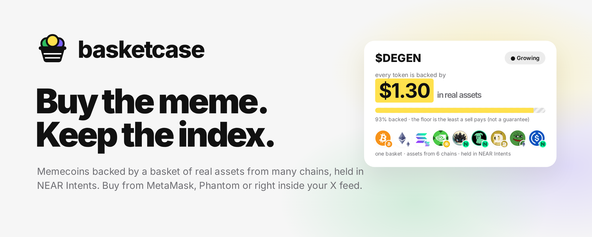
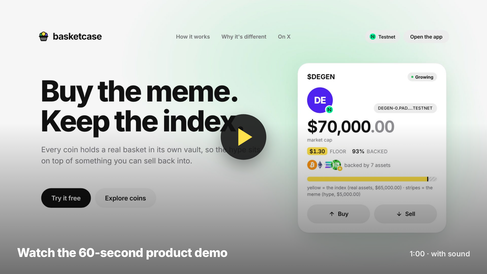
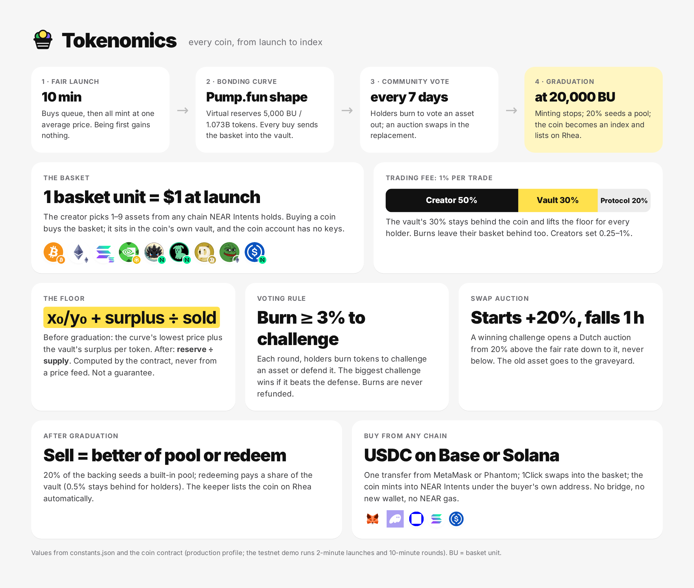
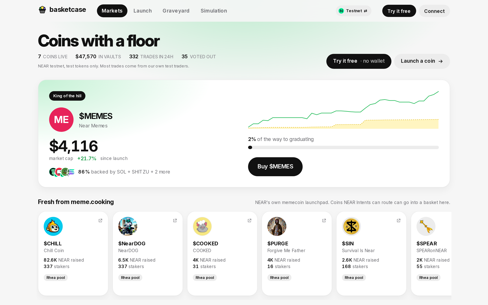

<p align="center">
  
</p>

<p align="center">
  <b>Memecoins with a basket of real assets underneath.</b><br>
  Built on <b>NEAR Intents</b> for NEAR HACKATHON 2026 · live on <b>NEAR mainnet</b> and testnet
</p>

<p align="center">
  <a href="docs/media/basketcase-product.mp4"></a>
  <br><sub>▶ Click to watch the 60-second product demo (<code>docs/media/basketcase-product.mp4</code>)</sub>
</p>

---

## The problem

| | What goes wrong today |
|---|---|
| 🪦 **Nothing underneath** | A memecoin is pure attention. When the hype ends it goes to zero, or it gets rugged, because no asset backs it. |
| 🌉 **Liquidity split across chains** | The coin you want is on another chain: bridge, new wallet, new seed phrase, buy gas first. Most people give up. |
| 📱 **Found on X, traded elsewhere** | People discover coins in their X feed, then have to leave it, open an app and connect a wallet to buy. |

## How Basketcase solves it

- **Every coin holds a basket.** The creator picks 1–9 real assets from any chain NEAR Intents holds (BTC, ETH, SOL, NVIDIA via Ondo, NEAR memes like BLACKDRAGON…). Buying a coin buys the basket, and it sits in the coin's own vault.
- **A floor the contract computes.** A line like "every token is backed by $1.30" (the illustrative figure in our images) is arithmetic on the coin's own state, never a price feed. 30% of every fee goes to the vault, so the floor only rises. (The floor is the least a sell pays, before the fee; not a guarantee.)
- **Holders run the basket.** Each round, holders burn tokens to vote an asset out; a Dutch auction swaps in the replacement.
- **Memecoin today, index tomorrow.** At 20,000 basket units the coin graduates into an index fund and is listed on Rhea (NEAR's DEX) automatically.
- **Buy from any chain.** Pay with USDC on Base (MetaMask) or Solana (Phantom): one transfer, then you sign messages. No bridge, no new wallet, no NEAR gas, and the coins land under your own wallet's address.
- **Buy inside your X feed.** A coin's link unfurls into a live card in the post: buy in one tap, sell in one more.

<p align="center"></p>

## Why it's different

| | Typical memecoin launchpad | **Basketcase** |
|---|---|---|
| What backs a coin | Nothing | A basket of real assets in the coin's vault |
| The floor | None | Computed by the contract; fees and burns only raise it |
| Who controls the backing | A team wallet | Nobody: coin accounts have no keys (testnet); holders vote on assets |
| Assets from other chains | Bridge them yourself | BTC, ETH, SOL, NVDA, NEAR memes in one basket via NEAR Intents |
| Paying from another chain | Bridge + new wallet + gas | One USDC transfer from MetaMask or Phantom |
| Where you trade | Leave X for an app | Inside the X post |
| End state | Dies or lives on a DEX | Graduates into an index, listed on Rhea automatically |
| Launch fairness | Snipers and bots win | Fair-launch window: everyone gets the same average price |

## See it

| Landing | Coin page |
|---|---|
|  |  |
| **Markets** | **The X card, inside a post** |
|  |  |

**Try it** (no wallet needed on testnet: a guest wallet with test tokens is made for you):
- Testnet app: https://fortune-literacy-counter-exceed.trycloudflare.com
- Mainnet app: https://therapeutic-amend-antibodies-midwest.trycloudflare.com

## Live on NEAR mainnet

$DEGEN (50% BTC, 50% USDC) is deployed at [`degen.basketcase.near`](https://nearblocks.io/address/degen.basketcase.near).

| Step | Transaction |
|---|---|
| Master account `basketcase.near` registered | [GFUK9C6z…](https://nearblocks.io/txns/GFUK9C6zUKa2RTx27yuamJa1Gv4oPJvFHFDitm7r42kj) |
| Coin account `degen.basketcase.near` created | [ZjHSwTBL…](https://nearblocks.io/txns/ZjHSwTBL3QgaMrdZSwE7NVqiA1scTZm8mxnMFJ4jJgk) |
| Coin contract deployed and initialised (`new`) | [GXP7y1NP…](https://nearblocks.io/txns/GXP7y1NPvSz7caavk7mwCq9FeNoA2J2xT3ENLPug5DBE) |
| NEAR Intents registered on the coin (`storage_deposit`) | [2GRnJQf7…](https://nearblocks.io/txns/2GRnJQf7oGdSwDKo6x1ZU9scssqBC3BEYcdMYXpochgM) |
| Gas relayer `router.basketcase.near` created | [2T82V7a3…](https://nearblocks.io/txns/2T82V7a3nbr6M8zBXpHPkzbZjppzSyrBfGAYfhMN6cb2) |

Checks anyone can rerun, all read-only:

```bash
pnpm install
pnpm --filter scripts intents:check     # mainnet NEAR Intents accepts MetaMask and Phantom signatures: 8 PASS
SITE=<mainnet app> pnpm --filter scripts mainnet:dryrun degen.basketcase.near   # 5 PASS, no money moves
pnpm verify                             # every offline check: Rust, simulator, unit, typecheck, browser: all PASS
```

**Honest status:** the mainnet coin is live and tradeable, and every step of the MetaMask/Phantom path has been checked against mainnet without moving money. No real buy has gone through it yet. Unlike testnet coins, this demo coin keeps an access key so it can be deleted and its storage NEAR recovered after judging. On testnet, every action (launch, buy, sell, vote, auction, graduation, Rhea listing, the X card) runs end to end with test tokens, checked by an automated live browser test.

## Built with

NEAR smart contracts in Rust (`near-sdk`) · NEAR Intents (multi-chain vault, signed intents) · 1Click (cross-chain swaps) · Rhea (DEX listing) · Next.js · TypeScript · MetaMask (ERC-191 signing) · Phantom (Ed25519 signing) · MongoDB

## Go deeper

- **[docs/technical.md](docs/technical.md)**: the full technical README for judges and agents. Every claim with its command, test or transaction; trust assumptions; testnet and mainnet setup; how to run it all.
- **[ARCHITECTURE.md](ARCHITECTURE.md)**: the code map and each flow end to end.
- **[docs/interface.md](docs/interface.md)**: contract methods and JSON shapes.
- **[docs/mainnet-runbook.md](docs/mainnet-runbook.md)**: how the mainnet deployment was done, and how it is cleaned up.

<sub>MIT licensed. Memecoins are risky: the floor is the least a sell pays before the fee, not a promise of value. NVDAon is Ondo's tokenized NVIDIA, for eligible non-US users only.</sub>
